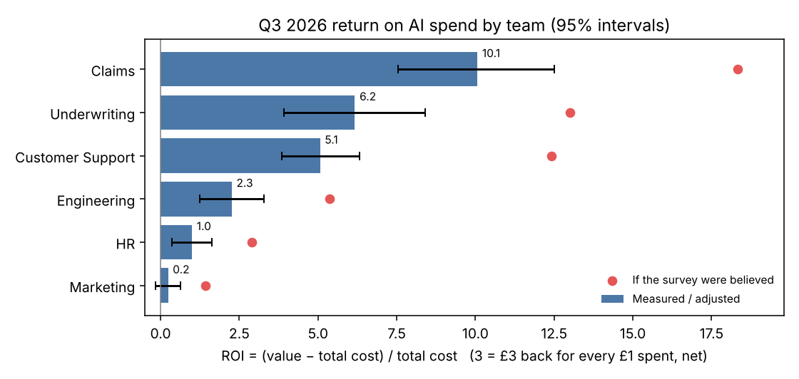
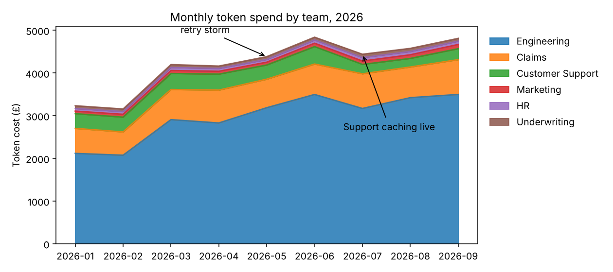
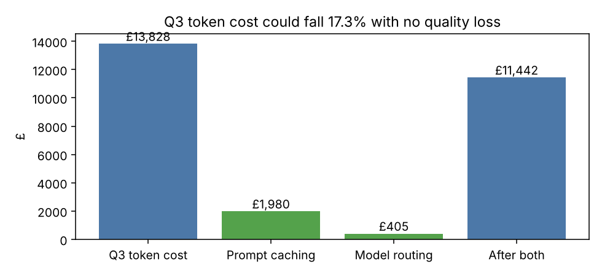
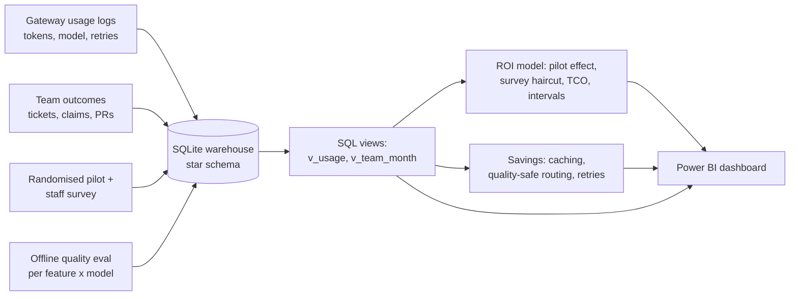

# AI Spend & ROI: tying every team's token bill to cost per outcome, and finding 17% savings with no quality loss

**[Walkthrough notebook](notebooks/walkthrough.ipynb)** · **[Power BI build guide](powerbi/README.md)** · **[Methods](docs/methods.md)** · **[Data](data/README.md)**

## Executive summary

- **Business question.** Northwind Insurance (fictional) spent £37.8k on model usage in nine months across six teams. Every team lead says the tools "save hours". The CFO wants one number per team: what does each outcome cost, and is it worth it?
- **Answer.** In Q3 2026, each £1 of total cost returned **£4.80 of staff time** (ROI 3.8). Self-reported time savings, checked against a randomised pilot, were **about twice** the truth: believing the survey would have doubled the reported return. **Tokens are only 43% of the real cost**; the platform team is the rest. Claims returns about £11 per £1; **Marketing does not clearly pay for itself** (ROI 0.2, interval includes a loss).
- **Recommendation.** Cache the coding assistant's prompt (£1.7k a quarter), route three simple features to cheaper models (−£0.4k, at most 2 points of quality), alert daily on retries (a May bug cost £835), put Marketing on probation, and run a pilot in Engineering before raising its budget.
- **Tools.** SQL (SQLite views, window functions) · Python (pandas, bootstrap) · Power BI (star schema, DAX) · matplotlib · pytest · GitHub Actions

## The headline table: cost per outcome, Q3 2026

| Team | Outcome | Token cost per outcome | Total cost per outcome | Minutes saved (method) | ROI (95% interval) |
|---|---|---|---|---|---|
| Claims | claim processed | £0.40 | £0.61 | 12.0 (pilot) | **10.1** (7.5–12.5) |
| Underwriting | quote issued | £0.10 | £0.62 | 5.5 (adjusted survey) | 6.2 (3.9–8.4) |
| Customer Support | ticket resolved | **£0.02** | £0.23 | 2.9 (pilot) | 5.1 (3.9–6.3) |
| Engineering | pull request merged | £8.12 | £14.18 | 44.8 (adjusted survey) | 2.3 (1.2–3.3) |
| HR | employee query answered | £0.23 | £0.93 | 3.5 (adjusted survey) | 1.0 (0.4–1.6) |
| Marketing | campaign asset approved | £1.25 | £6.45 | 12.0 (adjusted survey) | **0.2 (−0.2–0.6)** |

ROI = (value − total cost) / total cost, so 3.0 means £3 back for every £1 spent, net. Value is staff time freed, priced at each team's loaded hourly cost. Full table: [`reports/roi_q3_2026.csv`](reports/roi_q3_2026.csv).



## What the review found

**1. Spend is concentrated, and model choice drives it.** Engineering is 70% of the bill. The large model is 85% of spend, so which model a task uses matters more than prompt length.



**2. Staff over-report time saved by about 2×.** Customer Support and Claims ran a randomised pilot (items randomly handled with or without AI). Support measured 2.9 minutes saved per ticket against 6.5 self-reported; Claims measured 12.0 against 20.9. For teams without a pilot, survey figures are scaled by the pilot ratio (0.51) and given wider intervals.

**3. Tokens are less than half the cost.** The platform team (gateway, monitoring, on-call) costs more than the API bill. A review based on tokens alone would overstate ROI.

**4. One bug, two weeks, £835.** A client retry loop in Engineering billed about 75 retries per 100 requests (normal: 1.5) from 11 to 24 May. In monthly reporting it looked like growth. A daily alert on retries per request would have caught it on day one.

**5. Caching works, but only one team uses it.** Customer Support's cost per request halved (from £7.01 to £3.69 per 1,000 requests) when it cached its 3,000-token system prompt in July. The coding assistant resends a 2,500-token prompt on every call.

**6. Some tasks don't need the big model.** An offline quality evaluation shows HR answers are as good on the small model (95% vs 94% acceptance), while the coding assistant falls from 78% to 48%. Routing is decided per feature, with at most a 2-point quality drop.



## SQL

All metrics come from two shared views in [`sql/00_views.sql`](sql/00_views.sql), so "cost" and "outcome" mean the same thing in every report and on the dashboard.

| File | Question |
|---|---|
| [`01_spend_by_team.sql`](sql/01_spend_by_team.sql) | Where does the money go? (share of total with a window function) |
| [`02_unit_cost_q3.sql`](sql/02_unit_cost_q3.sql) | Token cost per business outcome |
| [`03_retry_waste.sql`](sql/03_retry_waste.sql) | Cost of failed and retried calls |
| [`04_caching_before_after.sql`](sql/04_caching_before_after.sql) | Did prompt caching pay? |
| [`05_budget_variance.sql`](sql/05_budget_variance.sql) | Who went over budget, and by how much |

## Dashboard (Power BI)

[`powerbi/`](powerbi) holds a star-schema extract (8 CSVs) and a [page-by-page build guide](powerbi/README.md) with every relationship and DAX measure. The three pages are: an executive summary ("is AI paying off?"), unit economics per team, and waste and savings. The ROI figures are computed and tested in Python and then sliced in Power BI, so the method lives in one place.

## Architecture



## Run it

```bash
pip install -r requirements.txt
PYTHONPATH=src python -m tokenroi.warehouse   # builds data/northwind_ai.db and powerbi/data/*.csv
PYTHONPATH=src python -m tokenroi.roi         # ROI, savings, figures -> reports/
pytest -q                                     # 10 tests
```

## Repository structure

```
├── src/tokenroi/
│   ├── data.py          seeded generator: usage, outcomes, pilot, survey, quality, prices
│   ├── warehouse.py     SQLite build + Power BI extract
│   └── roi.py           pilot effect, survey correction, TCO, ROI with intervals, savings
├── sql/                 shared views and the five review queries
├── powerbi/             star-schema CSVs and the build guide
├── notebooks/walkthrough.ipynb   the review, step by step (executed)
├── reports/             metrics.json, roi_q3_2026.csv, figures
├── docs/methods.md      every modelling choice and its limits
└── tests/               cost arithmetic, SQL vs pandas, pilot recovery, routing tolerance
```

## Tests

`pytest -q` runs 10 tests: the price formula against a hand calculation; generator reproducibility and internal consistency (cost equals price × tokens, caching only after go-live); SQL views agreeing with an independent pandas calculation; every SQL file running; the caching and retry-storm findings; the pilot estimator recovering a known effect inside its interval; the survey correction learning only from pilot teams; full allocation of platform cost; and routing never losing more than the quality tolerance.

## Limitations and judgement calls

- **Time freed is not cash saved.** The value is capacity. It becomes money only if the time goes to other work or avoids hiring, which is a management decision, and the report says so.
- **The survey correction assumes every team over-reports by about the same factor.** The intervals widen to reflect that, and a pilot in Engineering would replace the assumption with a measurement.
- **Offline acceptance rate is a proxy for quality.** Model changes should roll out behind an A/B test.
- **The data is synthetic.** The SQL, ROI method and dashboard transfer directly to real gateway logs.
